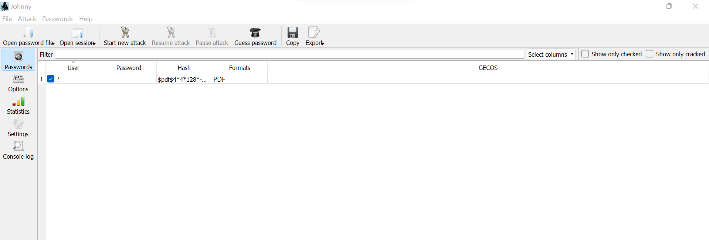

# Week 3 Cybersecurity Internship — Password Security Labs

**Programme:** Networkwalks Academy Cybersecurity Internship  
**Week:** 3  
**Environment:** Windows PC  
**Focus:** Password recovery, PDF protection, hash analysis, and ethical security testing

## Overview

During Week 3, I completed two practical password-security exercises using password-protected PDF files supplied for the internship. The exercises introduced me to password-recovery workflows, security-tool configuration, and the importance of strong passwords.

> **Ethics and scope:** These exercises were conducted on designated training files. Password recovery must only be performed on files you own or have explicit permission to test. Recovered passwords and sensitive file contents are intentionally excluded from this repository.

## Learning objectives

- Set up and use password-auditing tools in a Windows lab.
- Understand the difference between a file checksum and a password-cracking hash.
- Practice recovering access to authorised password-protected training PDFs.
- Document the workflow, evidence, results, and security lessons.

## Lab environment and tools

| Tool | Purpose |
| --- | --- |
| [John the Ripper](https://www.openwall.com/john/) | Password auditing and recovery |
| [Johnny GUI](https://openwall.info/wiki/john/johnny) | Graphical interface for John the Ripper |
| [OnlineHashCrack](https://www.onlinehashcrack.com/) | Hash extraction or analysis service used in the training workflow |
| [Networkwalks Hash Calculator](https://networkwalks.com/hash-calculator/) | Hash calculation in the second lab |
| [Networkwalks Password Cracker](https://networkwalks.com/password-cracker/) | Password recovery tool in the second lab |
| Windows | Host operating system |

**Important technical distinction:** A conventional file hash such as SHA-256 is a checksum of the entire PDF, not necessarily a format-specific password hash that can be used to recover the PDF's opening password. The actual input format and recovery method should be verified against the tools' documentation. Do not upload confidential files to third-party websites without permission.

---

## Project 1 — PDF password recovery with John the Ripper and Johnny GUI

### Objective

Recover the opening password of the authorised training file **My Locked PDF2.pdf**, using John the Ripper through the Johnny GUI on Windows.

### Procedure performed

1. Downloaded John the Ripper from its official source.
2. Downloaded and installed Johnny GUI, then configured it to use the John executable.
3. Downloaded the provided password-protected PDF training file.
4. Used the designated online service to obtain the password-recovery hash representation for the PDF.
5. Saved the resulting hash data to a local text file.
6. Opened Johnny and selected the prepared password-hash file.
7. Started a new authorised password-recovery attempt.
8. Used the recovered password to verify access to the training PDF.

### Result

**Reported outcome:** Password recovery was successful, and the PDF was opened using the recovered password.

### Screenshot Evidence included below

- Screenshot 1: John the Ripper and Johnny GUI installation/configuration.
- Screenshot 2: Prepared hash file, with sensitive values redacted.
- Screenshot 3: Johnny attack interface and completion status.
- Screenshot 4: PDF opened successfully, without showing confidential content or the password.

---

## Project 2 — PDF password recovery with Networkwalks tools

### Objective

Recover the opening password of the authorised training file **My Locked PDF3.pdf**, using the Networkwalks Hash Calculator and Password Cracker tools.

### Procedure performed

1. Downloaded the supplied password-protected PDF training file.
2. Opened the Networkwalks Hash Calculator.
3. Uploaded the designated training PDF and copied the output provided by the tool.
4. Opened the Networkwalks Password Cracker and submitted the required input.
5. Waited for the recovery process to complete.
6. Used the recovered password to verify access to the PDF.

### Result

**Reported outcome:** The password was recovered, and the training PDF was opened successfully.

### Evidences included below

- Screenshot 1: Networkwalks Hash Calculator interface.
- Screenshot 2: Generated output, with sensitive data redacted.
- Screenshot 3: Password Cracker result, with the recovered password concealed.
- Screenshot 4: Successfully opened training PDF.

---
## 📸 Screenshot Evidence – Project 1

### Screenshot 1: JTR and Johnny GUI Setup
Installation and configuration of John the Ripper (JTR) and Johnny GUI on Windows.



### Screenshot 2: PDF Hash Extraction
Password-related hash data extracted from the encrypted PDF and saved in a text file for analysis.


### Screenshot 3: Password Cracking with Johnny GUI
Johnny GUI displaying the password recovery process and successful completion of the attack.


### Screenshot 4: Successful PDF Access
The previously password-protected PDF opened successfully using the recovered password.


## Key lessons learned

1. **Password strength matters:** Short or predictable passwords can be vulnerable to guessing and password-auditing attacks.
2. **Tool configuration is important:** A graphical interface such as Johnny depends on a correctly configured password-recovery engine.
3. **Hash types must be understood:** A PDF password-recovery representation is not the same thing as a general-purpose file checksum.
4. **Verification is essential:** A recovery result should be validated against the authorised training file.
5. **Ethical boundaries matter:** Password testing requires permission, controlled lab conditions, and careful handling of sensitive information.

## Security recommendations

- Use long, unique, unpredictable passwords or passphrases.
- Protect sensitive documents with appropriate encryption and access controls.
- Use a trusted password manager to generate and store strong passwords.
- Avoid uploading sensitive documents or password material to untrusted third-party services.
- Do not publish recovered credentials, raw sensitive hashes, or confidential documents.

## Suggested repository structure

```text
Networkwalks-Week3-Password-Security-Labs/
├── README.md
└── screenshots/
    ├── pm1-johnny-setup.png
    ├── pm1-hash-redacted.png
    ├── pm1-recovery-result-redacted.png
    ├── pm1-pdf-verification.png
    ├── pm2-hash-calculator.png
    ├── pm2-output-redacted.png
    ├── pm2-recovery-result-redacted.png
    └── pm2-pdf-verification.png
```

*Screenshot filenames are placeholders; add your actual evidence files after reviewing them for sensitive information.*

## Disclaimer

This repository documents authorised educational cybersecurity labs only. It does not contain protected PDF files, recovered passwords, or reusable sensitive cracking material. The exercises are intended to promote understanding of password security and responsible defensive testing.
